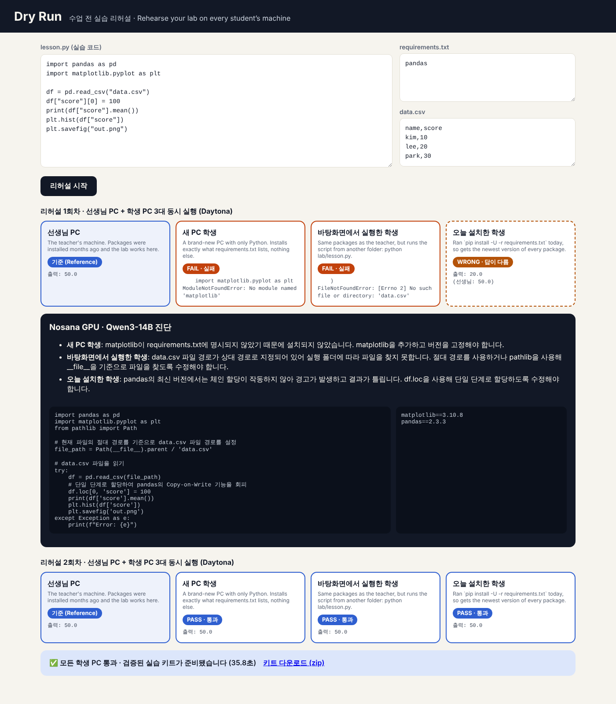
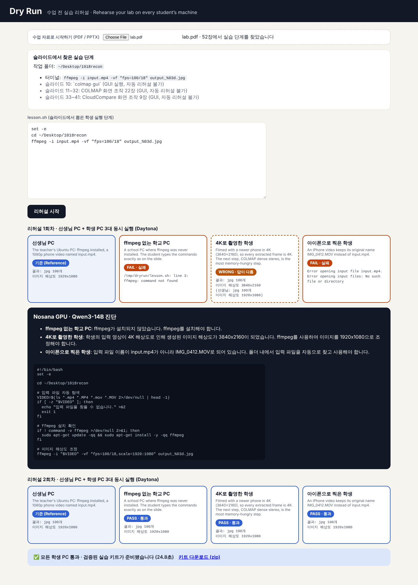

# Dry Run — 수업 전 실습 리허설

> **Rehearse your coding lab on every student’s machine — before class.**
> Daytona HackSprint Seoul (2026-10-18)

선생님 PC에선 잘 되던 실습이 수업 시간에 학생 PC 절반에서 튕긴다. Dry Run은 수업 전에 **서로 다른 학생 PC 여러 대를 Daytona 샌드박스로 동시에 띄워** 실습을 학생처럼 돌려보고, 크래시뿐 아니라 **에러 없이 답만 틀리는 경우**까지 잡아낸다. 그다음 **Nosana GPU에서 돌아가는 오픈소스 LLM**이 원인을 진단해 고치고, 모든 PC가 통과할 때까지 다시 돌려 **검증된 실습 키트**(고친 코드, 버전 고정 requirements, 리포트)를 돌려준다.



## 문제 (Problem)

- **실제 경험**: 고등학생 대상 3D 복원 실습(COLMAP)에서 모든 PC에 같은 설치 스크립트를 돌렸지만, 수업 중 약 절반의 PC가 튕겼다. 강사는 자기 PC, 자기 데이터로만 테스트했다.
- **업계 공통 문제**: Software Carpentry는 설치·설정을 워크숍 학습자의 가장 큰 난관으로 꼽는다(특히 Windows). 반대로 케임브리지 부트캠프는 실습실 PC를 미리 준비해 첫날 오전의 설치 시간 대부분을 없앴다. **미리 점검하면 해결된다.**
- **지금 더 심해지는 이유**: pandas 3.0(2026년 1월)이 Copy-on-Write를 유일한 동작 방식으로 바꾸면서(공식 breaking change), 기존 강의 코드가 **에러 없이 다른 답**을 내기 시작했다.

직접 측정한 결과 (같은 코드, Daytona 샌드박스 두 곳):

| 환경 | `df["score"][0] = 100` 후 평균 | 종료 코드 |
|---|---|---|
| 선생님 PC (pandas 2.3.3) | **50.0** | 0 |
| 오늘 설치한 학생 (pandas 3.0.6) | **20.0** | 0 (경고 한 줄뿐) |

## 해결책 (Solution)

1. **업로드**: 실습 코드, requirements.txt, 데이터
2. **학생 PC 생성 (Daytona)**: 선생님 PC + 학생 PC 3대를 병렬로 띄움
3. **결과 비교**: 선생님 출력이 기준. 실패 / 답이 다름 / 새 경고로 판정
4. **진단·수정 (Nosana)**: Nosana GPU 위 vLLM으로 띄운 Qwen3-14B가 원인을 한국어로 설명하고 코드와 requirements를 고침 (LLM이 실패하면 규칙 기반으로 대체)
5. **재실행 → 검증 키트**: 모든 PC가 통과할 때까지 반복, 키트를 zip으로 다운로드

### 학생 프로필

| 프로필 | 재현 방법 | 데모 실습에서 잡는 문제 |
|---|---|---|
| 선생님 PC | Daytona 기본 스냅샷 (패키지 이미 설치됨) | 기준 출력 |
| 새 PC 학생 | 빈 가상환경(venv)에 `pip install -r requirements.txt`만 설치 | requirements에 빠진 패키지 (matplotlib) |
| 바탕화면에서 실행한 학생 | 다른 폴더에서 `python lab/lesson.py` | 상대 경로 (`data.csv`) |
| 오늘 설치한 학생 | `pip install -U -r requirements.txt` (최신 버전) | pandas 3에서 **에러 없이 답이 바뀜** |

### 수업 자료(PDF / PPTX)로 시작하기



웹 화면에서 **수업 자료로 시작하기**에 PDF나 PPTX를 올리면:

1. 슬라이드에서 학생이 터미널에 입력하는 명령과 작업 폴더를 찾아 `lesson.sh`로 만든다 (`{영상 파일 이름}` 같은 템플릿 줄은 건너뛰고 슬라이드의 구체적 예시를 사용).
2. GUI로만 하는 단계(COLMAP, CloudCompare 화면 조작)는 슬라이드 범위와 함께 "자동 리허설 불가"로 따로 표시한다.
3. 영상 실습용 학생 프로필로 리허설한다.

| 프로필 | 재현 방법 | 실제 수업(3D 복원 실습)에서 잡은 문제 |
|---|---|---|
| 선생님 PC | ffmpeg 설치됨, 1080p 영상 `input.mp4` | 기준 결과 (jpg 100장, 1920x1080) |
| ffmpeg 없는 학교 PC | ffmpeg 패키지 제거 | 슬라이드 괄호 속 설치 안내를 놓치면 `command not found` |
| 4K로 촬영한 학생 | 4K 영상 | **에러 없이** 3840x2160 사진 100장 생성. 다음 단계 COLMAP dense stereo에서 GPU 메모리 초과 위험 |
| 아이폰으로 찍은 학생 | 파일명 `IMG_0412.MOV` | 슬라이드의 `input.mp4`가 없어 실패 |

## 혁신 포인트 (Innovation)

1. **PC 한 대가 아닌 반 전체**: 학생 프로필마다 독립된 Daytona 샌드박스(이미지, 패키지, 실행 위치가 다름)를 몇 초 만에 병렬로 실행
2. **조용히 틀린 답까지**: 크래시만 보는 CI와 달리, 모든 학생 출력을 선생님 출력과 비교
3. **프라이빗 AI + 검증 키트**: 오픈소스 LLM을 Nosana GPU에 직접 띄워 학생 코드가 유료 외부 API로 나가지 않음. 결과는 패치가 아니라 재실행으로 검증된 키트

## 스폰서 활용 (Sponsor usage)

- **Daytona**: 학생 PC 역할. 프로필마다 독립된 샌드박스를 병렬 생성, 파일 업로드, 설치·실행, 종료 후 삭제. 생성 실패 시 1회 재시도하고, 인프라 오류는 코드 문제와 구분해 표시 (`dryrun/runner.py`)
- **Nosana**: 진단 두뇌. Deployments API로 RTX 4090 마켓에 vLLM + Qwen3-14B-AWQ를 배포하고 OpenAI 호환 API로 호출 (`core/nosana.py`, `core/llm.py`, `dryrun/fixer.py`)

## 구조

| 파일 | 역할 |
|---|---|
| `dryrun/profiles.py` | 학생 프로필 정의 (Python 실습용, 영상·터미널 실습용) |
| `dryrun/slides.py` | PDF/PPTX에서 학생 실행 단계(lesson.sh)와 GUI 단계 추출 |
| `dryrun/runner.py` | 프로필별 Daytona 샌드박스 병렬 실행 |
| `dryrun/fixer.py` | 판정(선생님 출력 기준), LLM 진단·수정, 규칙 기반 대체 |
| `dryrun/engine.py` | 실행 → 판정 → 수정 → 재실행 루프, 리포트 |
| `dryrun/__main__.py` | CLI (`python -m dryrun`) |
| `app/main.py`, `app/index.html` | 웹 화면 (FastAPI) |
| `core/sandbox.py` | Daytona 클라이언트 |
| `core/nosana.py`, `core/llm.py` | Nosana LLM 배포·호출 |
| `examples/lesson1/` | 함정 3개를 심은 데모 실습 |
| `examples/recon3d/` | 영상 실습용 샘플 영상 (1080p, 4K, 각 18초) |

## 실행 방법

### 1. 설치

```bash
git clone https://github.com/kky0824/daytona_hacksprint.git
cd daytona_hacksprint
git checkout claude/hopeful-wright-jh5cap
python3 -m venv .venv && source .venv/bin/activate   # Windows: .venv\Scripts\activate
pip install -r requirements.txt
```

### 2. API 키 설정

```bash
export DAYTONA_API_KEY=<Daytona 대시보드 → API Keys>
export NOSANA_API_KEY=<Nosana 대시보드 → Developers → API Keys>
```

Windows PowerShell은 `$env:DAYTONA_API_KEY="..."` 형식으로 설정합니다.

### 3. LLM 준비 (Nosana)

```bash
python -m core.nosana status    # 이미 배포했다면: RUNNING과 엔드포인트 확인
python -m core.nosana deploy    # 없다면 새로 배포 (RTX 4090, 약 $0.36/시간, 기동 약 10분)
```

`status`를 실행하면 LLM 주소가 `nosana_deployment.json`에 저장되고 자동으로 사용됩니다. 직접 지정하려면 `export LLM_BASE_URL=https://<엔드포인트>.node.k8s.prd.nos.ci` 를 설정하세요. LLM이 없어도 규칙 기반 수정으로 데모는 동작합니다.

### 4. 연결 확인

```bash
python scripts/smoke_test.py    # Daytona, Nosana, LLM 모두 [OK]인지 확인
```

### 5-a. 웹 화면으로 실행 (데모용)

```bash
uvicorn app.main:app --port 8000
```

브라우저에서 http://localhost:8000 → **리허설 시작**. 데모 실습이 미리 채워져 있습니다.
수업 자료로 하려면 **수업 자료로 시작하기**에서 PDF/PPTX를 고른 뒤 **리허설 시작**을 누르세요.

### 5-b. CLI로 실행

```bash
python -m dryrun examples/lesson1 dryrun_kit
```

결과 키트는 `dryrun_kit/`(lesson.py, requirements.txt, REPORT.md)에 저장됩니다.

### 끝나면

```bash
python -m core.nosana stop      # GPU 과금 중지
```

## 로드맵

- 사양 리허설: 저사양(RAM 1GB) 샌드박스로 메모리 부족 재현
- 입력 리허설: 4K 사진, HEIC, 세로 영상 같은 학생 입력 자동 생성
- 설치 안내문 검증: AI가 초보 학생처럼 안내문을 한 줄씩 따라 하며 빠진 단계 찾기
- GPU 실습 리허설: COLMAP 같은 무거운 실습을 GPU 샌드박스나 Nosana에서
- 학기 중 자동 재검증: 라이브러리 업데이트 시 기존 자료가 깨지는지 주기 점검
